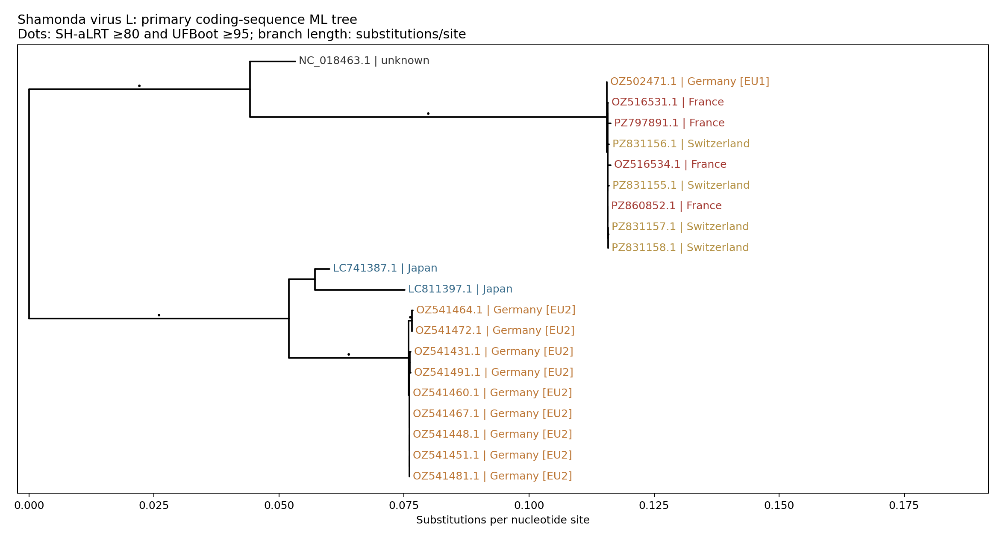
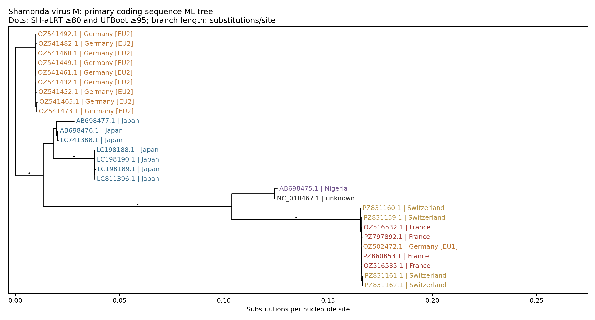
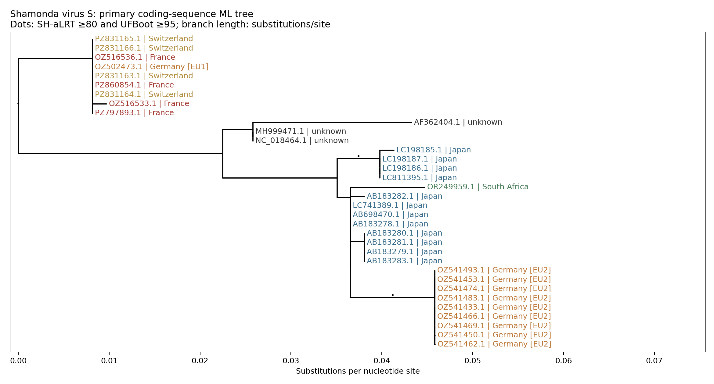

# Shamonda virus phylogenomics: baseline findings

Public snapshot retrieved 2026-10-22T21:09:47.937213+00:00. Research analysis, not a clinical diagnostic or transmission inference.

## Data coverage

The inventory contains 97 SHAV nucleotide records and 94 canonical focal segment records, plus curated Simbu context and a Bunyamwera outgroup. These are segment/accession counts, not independent animals or genomes. The linked raw-read catalog contains 20 runs; reads were not downloaded.

Every inclusion, duplicate, original annotation and source query is auditable in [the manifest](../data/public/manifest.json), [metadata](../data/public/metadata.tsv) and [sequence acknowledgments](sequence_acknowledgments.tsv). Unknown metadata remain unknown.

## Do European sequences cluster together?

Europe is tested from deposited country metadata; EU1/EU2 project labels are kept separately from tree conclusions. A Europe-exclusive cluster requires that the MRCA contains no non-European or context tips.

| Segment | Focal / total backbone tips | Coding sites | Europe-exclusive monophyly | Supported Europe-only groups | Model |
|---|---:|---:|---|---:|---|
| L | 21 / 31 | 6762 | No | 2 | GTR+F+I+R2 |
| M | 27 / 37 | 4209 | No | 1 | GTR+F+I+G4 |
| S | 34 / 44 | 699 | No | 1 | TPM2u+G4 |

Groups use SH-aLRT ≥80 and UFBoot ≥95. Separate Europe-only groups do not establish separate transmission chains. Sparse sampling and unresolved branches limit interpretation.

The earlier France/Germany/Switzerland tip set is distinct from the second German project (EU2), which falls nearer Japanese references. European sampling therefore spans separate genetic backgrounds. Support is segment-dependent:

| Segment | Earlier European group, SH-aLRT / UFBoot | EU2, SH-aLRT / UFBoot |
|---|---:|---:|
| L | 100 / 100 | 100 / 100 |
| M | 100 / 99 | 74.7 / 88 |
| S | 87.8 / 91 | 99.5 / 100 |

The M branch for EU2 and the S branch for the earlier European group fall below the prespecified joint strong-support thresholds. Their displayed grouping should not be described as equally well resolved as the other branches.

### L segment

[Full context tree](../figures/tree_L.pdf), [interactive dataset](../auspice/shamonda_L.json), [support table](../results/L/clades.tsv), [callable-site distances](../results/L/distances.tsv).

European focal tips: 18. Other members within their shared ancestor: LC741387.1, LC811397.1, NC_018463.1, NC_043583.1. Primary supported unrooted splits retained in the complete-case alignment: 11 of 11. This comparison measures topology sensitivity, not an accuracy percentage.

Primary sites: 6762; complete-case sites: 6501. Partial-CDS supplementary windows: 3; their coordinates, included records and alignments are recorded in prepared.json. The backbone uses the primary CDS, so S describes N, not the full overlapping N/NSs sequence.

### M segment

[Full context tree](../figures/tree_M.pdf), [interactive dataset](../auspice/shamonda_M.json), [support table](../results/M/clades.tsv), [callable-site distances](../results/M/distances.tsv).

European focal tips: 18. Other members within their shared ancestor: AB698475.1, AB698476.1, AB698477.1, LC198188.1, LC198189.1, LC198190.1, LC741388.1, LC811396.1, NC_018467.1. Primary supported unrooted splits retained in the complete-case alignment: 14 of 14. This comparison measures topology sensitivity, not an accuracy percentage.

Primary sites: 4209; complete-case sites: 3909. Partial-CDS supplementary windows: 3; their coordinates, included records and alignments are recorded in prepared.json. The backbone uses the primary CDS, so S describes N, not the full overlapping N/NSs sequence.

### S segment

[Full context tree](../figures/tree_S.pdf), [interactive dataset](../auspice/shamonda_S.json), [support table](../results/S/clades.tsv), [callable-site distances](../results/S/distances.tsv).

European focal tips: 18. Other members within their shared ancestor: AB183278.1, AB183279.1, AB183280.1, AB183281.1, AB183282.1, AB183283.1, AB698470.1, AF362404.1, LC198185.1, LC198186.1, LC198187.1, LC741389.1, LC811395.1, MH999471.1, NC_018464.1, NC_043582.1, OR249959.1. Primary supported unrooted splits retained in the complete-case alignment: 6 of 6. This comparison measures topology sensitivity, not an accuracy percentage.

Primary sites: 699; complete-case sites: 621. Partial-CDS supplementary windows: 0; their coordinates, included records and alignments are recorded in prepared.json. The backbone uses the primary CDS, so S describes N, not the full overlapping N/NSs sequence.

## Segment histories and evolutionary timing

The concordance analysis matches 17 explicit SHAV source-identity units across all three backbones and detects 0 supported incompatible split pairs that survive complete-case masking. This conservative screen does not establish absence of historical reassortment. [The complete comparison](segment_concordance.json) retains exact accession mappings. Historical context viruses are not counted as new SHAV reassortment candidates. Discordance does not identify a donor, timing, direction or phenotypic change.

Root-to-tip collection-date diagnostics include 100 seeded date permutations and an alternative midpoint root. These diagnostics are phylogenetically non-independent and sensitive to repeated isolates, missing dates and uneven sampling. No calibrated evolutionary rate, dated origin or migration route is reported. See each segment's analysis.json.

## Is a human-case sequence publicly available?

No explicitly human-labelled SHAV nucleotide sequence was identified in this snapshot. Both recorded NCBI human-keyword sensitivity queries returned zero results. However, 50 focal records lack a host qualifier, so global absence cannot be established. No case accession was identified in the inspected October 22 ECDC or Inserm announcements. IHUMI_Shav000001 (PZ860852–PZ860854) is explicitly cattle and must not be relabelled as the human case.

## Disease, transmission and countermeasures

The [canonical evidence table](../docs/evidence.tsv) separates direct SHAV observations, related-virus evidence and hypotheses. It records the newly reported human infection, animal disease associations, gene functions and current countermeasure evidence. WOAH reports no commercially available SHAV vaccine. Evidence does not establish that an observed mutation predicts virulence, human susceptibility, transmissibility or countermeasure failure. [Observed coding differences](observed_coding_variants.tsv) are descriptive and carry no phenotype score.

## Methods and reproducibility

Independent protein-guided MAFFT alignments were backtranslated to nucleotides. The near-complete threshold is 90% of the upper-half median focal CDS length; up to 5% ambiguous nucleotides are allowed. Unannotated focal records use explicitly flagged reference-guided ORF recovery with ≥70% aligned amino-acid identity and ≥50 matched residues. Invalid translations are excluded with reasons. The primary mask retains codons with at most 50% missing sequence; the complete-case sensitivity excludes every incomplete codon. IQ-TREE ModelFinder selects the model with 1,000 ultrafast bootstrap and 1,000 SH-aLRT replicates, seed 159150. Main trees use the Bunyamwera outgroup; midpoint rooting is a sensitivity comparison. Neither root establishes the geographic origin of SHAV.

Run `make ingest`, `make build`, `make report` and `make validate`. View locally with `make view`. New cases use `make place SEQUENCES=case.fasta METADATA=case.tsv`; see [placement](../docs/placement.md). Private inputs and reports remain ignored by Git.
